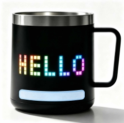

# Touch

Touch 是 PixelMug S1 Pro/Lite 底部的触摸区域。系统负责检测触摸、消抖并识别操作，MPY 应用从底层队列中读取已经识别出的单击和双击事件。

::: info 模块名称
PixelMug 提供的是底部触摸区域，不是机械按键。面向开发者的功能名称是 **Touch**。Python 模块和 `mps.json` 依赖叫 `mpy_button`。
:::



*PixelMug 底部触摸区域*

## Touch 如何工作

MPY 应用不直接轮询触摸 GPIO。GPIO 状态变化先唤醒系统任务，完成消抖和操作识别，再把应用可以使用的事件放入固定长度队列：

```text
PixelMug 底部触摸区域
        ↓
系统触摸任务
        ↓ 消抖与操作识别
click / double → Touch 事件队列 → mpy_button
long press     → 系统退出流程
```

触摸识别在系统任务中进行，不依赖 Python 主循环的执行速度。即使应用暂时忙于绘图、音频、BLE 或文件操作，系统任务仍会继续识别触摸；但应用长时间不读取事件时，队列仍可能溢出。

## 开始使用

在项目的 `mps.json` 中声明组件：

```json
{
  "dependencies": [
    {
      "name": "mpy_button",
      "version": ">=1.0.0"
    }
  ]
}
```

模块不需要初始化。应用启动时先清除前一个运行阶段可能留下的事件，再定期调用 `get()`：

```python
import time
import mpy_button as touch

touch.clear()

print("触摸屏幕底部的区域，尝试单击和双击操作")

while True:
    event = touch.get()
    if event == "click":
        print("单击")
    elif event == "double":
        print("双击")
    time.sleep_ms(10)
```

`get()` 没有事件时立即返回 `None`，不会阻塞。

## 支持的触摸操作

| 操作 | MPY 结果 | 当前识别规则 |
| --- | --- | --- |
| 单击 | `"click"` | 有效短触摸释放后，在 250 ms 内没有出现第二次有效触摸 |
| 双击 | `"double"` | 第二次触摸在第一次释放后的 250 ms 内开始，并完成第二次有效短触摸 |
| 触摸状态 | `is_pressed()` | 返回系统当前记录的触摸状态，不进行单击或双击判定 |

一次触摸至少持续 50 ms 才会被识别为有效短触摸。持续达到 1,000 ms 后按长按处理，不再产生单击或双击事件。

### 为什么单击有短暂延迟

第一次短触摸释放时，系统还不能确定它是单击，还是双击的第一次触摸。因此会继续等待 250 ms：

- 窗口内出现第二次有效触摸，产生 `"double"`。
- 窗口结束仍没有第二次触摸，产生 `"click"`。

所以 `"click"` 通常会在手指释放约 250 ms 后进入队列。这是区分单击和双击所需的等待，不是 `get()` 或 Python 运行速度造成的延迟。

## 单击事件与即时按下状态

应用只需要单一触摸动作，而且希望按下时立即响应，可以对 `is_pressed()` 做上升沿检测。它绕过单击与双击判定，因此响应比等待 `"click"` 更快：

```python
import time
import mpy_button as touch

print("触摸屏幕底部的区域，尝试快速单击")

last_pressed = touch.is_pressed()

while True:
    pressed = touch.is_pressed()
    if pressed and not last_pressed:
        print("触摸区域刚刚被按下")
        # 在这里执行低延迟的单一触摸动作。
    last_pressed = pressed
    time.sleep_ms(10)
```

这里必须检测 `False → True` 的变化。直接写成 `if touch.is_pressed()` 会在手指按住期间重复执行动作。

`is_pressed()` 返回的是当前按住状态，不是经过完整手势识别的“单击”：

- 双击会出现两次按下边沿。
- 长按也会先出现按下边沿，达到 1 秒后再进入系统退出流程。
- 它不提供系统的完整短触摸消抖结果。
- 如果应用同时处理 `"double"`，第一次和第二次按下可能已经触发即时动作，随后又收到 `"double"`，造成重复或冲突。

因此应在下面两种方式中选择一种：

| 应用需求 | 推荐方式 |
| --- | --- |
| 只需要一个低延迟触摸动作，不区分双击，比如游戏中发射子弹、控制精灵跳起等低延迟交互 | 对 `is_pressed()` 做上升沿检测 |
| 同时需要单击和双击，或需要系统确认完整短触摸，比如音乐播发器，单击暂停或继续播放，双击切换下一首曲目 | 使用 `get()` 返回的 `"click"` / `"double"` |

不要让同一个业务动作同时响应 `is_pressed()` 上升沿和 `"click"`。如果需要单击与双击，也不要用 `is_pressed()` 提前执行单击动作。

### 对比两种方式的响应时间

下面的示例代码打印 `is_pressed()` 的按下与释放状态，以及系统识别结果，并计算从释放到收到 `click` 的时间。它只用于观察，不应把两条路径同时接到同一个业务动作：

```python
import time
import mpy_button

mpy_button.clear()
last_pressed = mpy_button.is_pressed()
released_at = None

while True:
    now = time.ticks_ms()
    pressed = mpy_button.is_pressed()

    if pressed and not last_pressed:
        released_at = None
        
    if not pressed and last_pressed:
        released_at = now
        print("is pressed")

    event = mpy_button.get()
    if event == "click":
        if released_at is None:
            print("get：识别到 click")
        else:
            elapsed = time.ticks_diff(now, released_at)
            print("get：识别到 click，距 is pressed 约", elapsed, "ms")
    elif event == "double":
        print("get：识别到 double")

    last_pressed = pressed
    time.sleep_ms(10)
```

单击完成时会先看到 `is pressed`，再经过约 250 ms 的双击等待窗口收到 `click`。双击时会看到两次 `is pressed`，最终只收到一个 `double`。

## 事件读取模型

Touch 使用拉取队列，不会从系统任务直接调用 Python 回调。应用应在自己的主循环或 MicroPyxel `update()` 中读取事件。

如果应用一次循环可能积压多个事件，可以一次读取多条：

```python
def update():
    for _ in range(4):
        event = mpy_button.get()
        if event is None:
            break
        handle_touch(event)
```

`get()` 和 `get_event()` 消费同一个队列。任何一个接口成功返回事件后，该事件就已经从队列中移除。

## API 参考

所有接口都不接收参数。

### `get()`

取出并移除队列中最早的一条事件。

- `"click"`：单击。
- `"double"`：双击。
- `None`：队列为空。

普通应用优先使用这个接口。

### `get_event()`

取出并移除一条包含诊断信息的事件：

```python
event = mpy_button.get_event()
if event is not None:
    event_type, tick_ms, seq = event
```

返回值为 `("click", tick_ms, seq)`、`("double", tick_ms, seq)` 或 `None`。

| 值 | 含义 |
| --- | --- |
| `event_type` | `"click"` 或 `"double"` |
| `tick_ms` | 系统识别完成并将事件放入队列时的系统 tick 毫秒值 |
| `seq` | 系统运行期间持续递增的事件序号 |

`tick_ms` 不是日期时间，也不是手指首次接触屏幕的时间。它来自底层固件系统 tick，会按 32 位计数回绕，适合诊断事件顺序和大致间隔。`clear()` 不会将 `seq` 重置为 0。

### `clear()`

清空所有尚未读取的事件，返回 `None`。推荐在 MPY 应用启动、切换页面或切换交互模式时调用。

`clear()` 只清空当前队列，不重置事件序号、累计丢弃数量、最近事件或当前按住状态。

### `available()`

返回当前队列中的事件数量，范围为 `0..16`。

这个值只是调用时的快照。通常不需要先调用 `available()`，可以直接重复调用 `get()`，直到返回 `None`。

### `is_pressed()`

返回布尔值，表示系统当前记录的触摸区域状态。

它适合即时按下反馈和诊断，也可以用于只需要一种低延迟触摸动作的应用。它不替代系统的单击、双击和长按识别，使用限制见[单击事件与即时按下状态](#单击事件与即时按下状态)。

### `stats()`

返回当前 Touch 队列和触摸状态的诊断字典：

```python
print(mpy_button.stats())
```

| 字段 | 含义 |
| --- | --- |
| `queued` | 当前队列中的事件数量 |
| `seq` | 最近分配的事件序号；尚未产生事件时为 0 |
| `dropped` | 队列满时被覆盖的旧事件累计数量 |
| `last` | 最近入队的 `"click"` 或 `"double"`；尚无事件时为 `None` |
| `last_tick` | 最近入队事件的固件 tick 毫秒值 |
| `pressed` | 当前触摸状态 |

`stats()` 只读取状态，不消费事件。`clear()` 不会重置这些累计信息。

## 长按与退出 MPY

长按由系统保留，不会返回 `"long"`，MPY 应用也不能使用它。

当前 MPS 运行模式下：

1. 持续触摸达到 1 秒，系统显示退出确认。
2. 再次长按，确认退出 MPY 应用。
3. 退出确认显示期间，单击或双击会取消退出。
4. 用来取消退出的单击或双击不会进入应用队列。

使用 `is_pressed()` 时，应用可能已经在长按刚开始时执行即时动作；随后触摸达到 1 秒，系统仍会进入退出流程。因此不要把必须长时间按住的操作设计在这个触摸区域上。

## 队列容量与性能

Touch 队列固定容纳 16 条事件，不进行动态内存分配。

队列满时会丢弃最旧的一条事件、保留最新事件，并让 `stats()["dropped"]` 增加 1。

系统识别触摸不依赖 Python 主循环，但队列容量有限。应用应定期读取事件；绘图或其他工作较重时，可以在每次更新中处理有限数量的积压事件。

## 与 MicroPyxel 配合

完整示例在 PixelMug Studio 位于：

```text
examples/mpy-tutorial/examples/upyxel-events
```

该示例让屏幕计数器每 500 ms 增加一次。单击 Touch 后，`mpy_button.get()` 取得 `"click"`，再通过 MicroPyxel 的 `emit()`、`on()` 和 `state()` 暂停或恢复计数器。

```text
Touch click
    ↓
mpy_button.get()
    ↓
micropyxel.emit("toggle_pause")
    ↓
MicroPyxel 事件处理器修改应用状态
```

## 使用建议

- 应用启动时先调用 `clear()`，避免处理前一个运行阶段留下的事件。
- 同时需要单击和双击时，只使用 `"click"` 和 `"double"`。
- 只需要一种低延迟操作时，可以对 `is_pressed()` 做上升沿检测。
- 不要把 `get()` 与 `get_event()` 当成两路独立输入。
- 不要重新读取 GPIO，也不要在 Python 中重新实现完整的单击和双击状态机。
- 不要依赖长按事件，长按由系统保留。
- 使用 `stats()` 排查事件积压和队列溢出。
