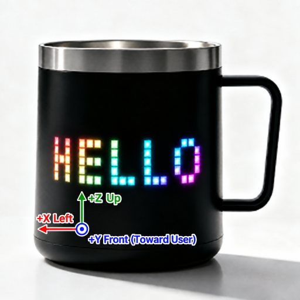
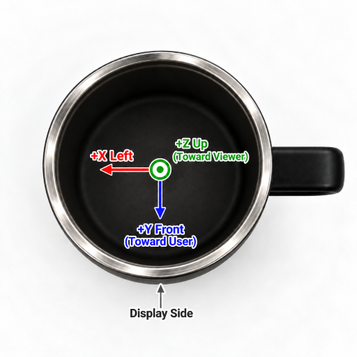

# Read Sports Data

G-sensor provides a four-digit acceleration, angular velocity, orra attitude angle and attitude. The component is continuously sampled and the last complete result is kept. Python reads the snapshot.

## How the data snapshots are updated

The current component uses 50 Hz configuration, with a target update interval of about 20 ms. A valid snapshot contains:

```text
qx, qy, qz, qw
yaw, pitch, roll
gx, gy, gz
ax, ay, az
```

These values are updated at the bottom as a whole. To keep the applications compatible, `get_attitude()` returns only the original nine values of Euro, Angle and Acceleration; the four figures are read separately by `get_quaternion()`.

It is likely that the same snapshot will be obtained twice in a row at a distance of about 20 ms. This is normal and does not mean that the sensor is not working.

When the initialization is completed but the first valid sample has not been generated, the reading interface will be thrown out:

```text
RuntimeError: get_attitude failed
```

Application should wait `STATUS_OK`. See full initialization.[G-sensor Quick Start](./#快速开始).

## Coordinate axis

`get_accel()` and `get_gyro()` returns the physical amount of the sensor X, Y, Z three-axis data converted. Currently, only unit conversions are made, no axle remagnation interfaces are called in G-sensor components, and no exchange or reverse axis is held on the Python layer.

PixelMug S1 live results are as follows:



*PixelMug G-sensor Coordinate System (ongoing observation of glass)*



*PixelMug G-sensor Coordinate System Overlooking View (Display Side on the side of the screen)*

| G-sensor Direction | Water Cup Direction |
| --- | --- |
| `+X` | Left to User |
| `-X` | To the right of the user |
| `+Y` | Forward, close to user |
| `-Y` | Backwards away from users |
| `+Z` | Up, point to the cup. |
| `-Z` | Down, point to the bottom of the cup. |


When revalidation of hardware version or installation direction is required, the Studio example can be run:

```text
examples/mpy-tutorial/examples/motion-axis-calibration
```

Tests are carried out in the cup direction and only in a straight line. The program subtracts the static baseline and cross-checks each other in the opposite direction.


## `get_accel()`: Three-axis acceleration

```python
ax, ay, az = g_sensor.get_accel()
```

Do not accept parameters, return 3-bit group:

| Return value | Meaning | Units |
| --- | --- | --- |
| `ax` | X-axis acceleration | g |
| `ay` | Y-axis acceleration | g |
| `az` | Z-axis acceleration | g |

The current range is ± 8 g. The base converts the original integer of the sensor to g as follows:

```text
Speed (g)= Original value / 32768 × 8
```

### Return value contains gravity

The velocity data also contain:

- The weight of gravity on three axes.
- The acceleration of motion, movement, shaking, collision, etc.

The three axes are not necessarily 0 when the mug is still. Depending on the direction of the placement, gravity falls mainly on one or more of the axes.

```python
import math
import time
import g_sensor


if not g_sensor.init():
    raise RuntimeError("g_sensor init failed")

try:
    deadline = time.ticks_add(time.ticks_ms(), 5000)

    while True:
        if time.ticks_diff(deadline, time.ticks_ms()) <= 0:
            raise RuntimeError("g_sensor not ready")

        if g_sensor.is_ready() == g_sensor.STATUS_OK:
            try:
                ax, ay, az = g_sensor.get_accel()
                break

            except RuntimeError:
                pass

        time.sleep_ms(20)

    magnitude = math.sqrt(ax * ax + ay * ay + az * az)

    print("accel:", ax, ay, az)
    print("acceleration magnitude:", magnitude)
finally:
    g_sensor.deinit()
```

Sensor error, vibration and sampling fluctuations can cause the result to deviate from the desired value.

### Use initial values as a baseline for application

When applying a relative change of interest, the acceleration on startup can be recorded:

```python
base_x, base_y, base_z = g_sensor.get_accel()

while True:
    ax, ay, az = g_sensor.get_accel()

    dx = ax - base_x
    dy = ay - base_y
    dz = az - base_z

    handle_motion(dx, dy, dz)
```

This is an application layer benchmark that does not calibrate sensors.

## `get_gyro()`: Three-axis velocity

```python
gx, gy, gz = g_sensor.get_gyro()
```

Do not accept parameters, return 3-bit group:

| Return value | Meaning | Units |
| --- | --- | --- |
| `gx` | X Axis Speed | °/s |
| `gy` | Y axle velocity | °/s |
| `gz` | Z Axis Speed | °/s |

The current default range is ± 2000 °/s. The base interface of the sensor returns a symbol 16-bit original, and the G-sensor component is converted `原始值 / 32768 × 量程` to °/s according to the configuration scale; `get_gyro()` returns an agular velocity after conversion.

Angular velocity is appropriate to detect rapid rotation, volatilization and rotation.

```python
gx, gy, gz = g_sensor.get_gyro()

if abs(gz) >= 120:
    print("fast rotation on Z:", gz)
```

`120` is only an example of applying a threshold, not a sign threshold that is built into the solid.

## `get_euler()`: attitude angle

```python
yaw, pitch, roll = g_sensor.get_euler()
```

Do not accept parameters, return 3-bit group in degrees:

| Return value | Current range of calculations | Meaning |
| --- | --- | --- |
| `yaw` | About 0-360 degrees | Angle. |
| `pitch` | About 90-90 degrees | ♪ Down on the tip ♪ |
| `roll` | About 180-180° | Queue Angle |

Attitude angles are not data directly exported by the sensor. The current result is to convert the original gyroscope value to °/s and then give the three-axis velocity and three-axis acceleration to the Mahony IMU algorithm. Mahony uses the same timescale as the sample configuration; the current default sampling rate is 50 Hz.

The current calculations do not use magnetometers, so:

- Pitch and roll can use gravity to fix it.
- Yaw does not have an absolute position reference, and it moves with gyro error.
- Yaw cannot be used as a compass.
- After the re-initiation of the component, the attitude integration status will be reset.

Rapid linear movements change the direction of acceleration and may therefore temporarily affect integration postures.

## `get_quaternion()`: attitude four-digit

```python
qx, qy, qz, qw = g_sensor.get_quaternion()
```

Do not accept parameters, return the current Mahony attitude mixer to the unified four-digit number:

| Return value | Meaning |
| --- | --- |
| `qx` | Vector weight for the X-axis |
| `qy` | Vector weight for y-axis |
| `qz` | Vector mass for Z axis direction |
| `qw` | Scale |

The order of return is `(x, y, z, w)`, which corresponds to the `Quaternion` parameter of Three.js, and does not require re-numbering. The bottom merger internal is saved at `(w, x, y, z)`; the Python interface has been reordered. The attitude for the 3D model still requires a fixed coordinate change according to the direction of the sensor installation and the model coordinates.

The four-digit number is suitable for a continuous three-axis rotation, a 3D viewer attitude transfer, and a spherical linear interpolation between two positions. It avoids the one-way lock and angle-crossing problem of the corner of Ora when approaching a given attitude. `q` is the same rotation as `-q`; in the continuous processing of the data, the interpolation value can be based on the point-cum-cum-cum-four symbol.

The four-digit figure and the angle of the Ori came from the same Mahony integration state, so the following limitations apply: there are no magnetometers at present, and the absolute direction in which the gravitational direction is drifting; fast linear motion may also affect integration results for a short time.

```python
import math

qx, qy, qz, qw = g_sensor.get_quaternion()
norm = math.sqrt(qx * qx + qy * qy + qz * qz + qw * qw)
print("quaternion:", qx, qy, qz, qw)
print("norm:", norm)
```

Normal data should be approximated by `1`. Applications do not normally need to be normalized once again; after transmission across the network or participation in multi-step float-point calculations, they can be normalized at the receiving end.

## `get_attitude()`: Full snapshot

```python
data = g_sensor.get_attitude()

(
    yaw, pitch, roll,
    gx, gy, gz,
    ax, ay, az,
) = data
```

Do not accept parameters, return values are fixed to:

| Location | Value | Units |
| ---: | --- | --- |
| 0 | `yaw` | degrees |
| 1 | `pitch` | degrees |
| 2 | `roll` | degrees |
| 3 | `gx` | °/s |
| 4 | `gy` | °/s |
| 5 | `gz` | °/s |
| 6 | `ax` | g |
| 7 | `ay` | g |
| 8 | `az` | g |

When multiple types of data need to be used in the same application, priority is given to `get_attitude()`:

```python
yaw, pitch, roll, gx, gy, gz, ax, ay, az = (
    g_sensor.get_attitude()
)
```

The current snapshot is obtained each time you call `get_euler()`, `get_gyro()` and `get_accel()`, respectively; the backstage may be able to complete an update between calls. All values need to be strictly derived from the same snapshot, using `get_attitude()`.

## Read in Main Cycle

### Normal cycle

```python
import time

while True:
    ax, ay, az = g_sensor.get_accel()
    update_physics(ax, ay, az)
    time.sleep_ms(20)
```

### MicroPyxel Update Cycle

```python
def update(rt):
    ax, ay, az = g_sensor.get_accel()
    update_scene(ax, ay, az)
```

MicroPyxel is only able to read once per frame when running at 30 FPS. Do not read dozens of times in the same frame without spacing; these calls usually only get the same cache data.

## Smooth and Threshold

Sensor data are subject to normal fluctuations. Do not use `value == 0` to judge static, and apply a threshold:

```python
gx, gy, gz = g_sensor.get_gyro()

still = (
    abs(gx) < 3
    and abs(gy) < 3
    and abs(gz) < 3
)
```

The above `3°/s` is a demonstration value that needs to be tested by device and use.

A simple low-intensity treatment in the application level is needed to make the image more smooth:

```python
smooth_x = 0.0
smooth_z = 0.0

def update_motion():
    global smooth_x, smooth_z

    ax, ay, az = g_sensor.get_accel()

    smooth_x = smooth_x * 0.8 + ax * 0.2
    smooth_z = smooth_z * 0.8 + az * 0.2

    return smooth_x, smooth_z
```

The filter reduces the shaking and increases the response delay.

## Errors and Limits

Five reading interfaces may be dropped without a valid snapshot:

```text
RuntimeError: get_attitude failed
```

This includes cases where the first valid sample has not yet been obtained. The current interface does not provide different error text for the four modes of reading.

Other restrictions:

- Python API cannot modify the range, sampling frequency or Mahony parameter.
- Read the interface back to the latest snapshot and do not guarantee that each call is a new sample.
- The acceleration velocity consists of gravity and motion weights.
- No magnetometers, yaws and absolute deviations in four-digits.
- Four-digits are complete rotations and cannot be used as separate three angles.
- Rapid movement, collisions and vibrations may temporarily affect attitude stability.
- The source code does not provide a definition of the direction of the hardware installation and the coordinates should be measured.
- Do not verify each sample with HF `print()`; log output reduces the application cycle speed.
