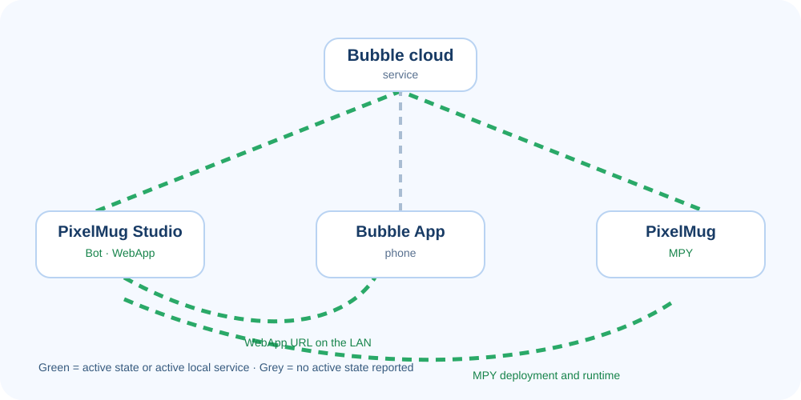

# PixelMug Studio

PixelMug Studio is the local workspace for selecting a project, running its Bot and optional WebApp, binding PixelMug devices, deploying MicroPython (MPY), and reading logs.

## Install or build from source

PixelMug Studio is open source on [GitHub](https://github.com/bubble-pixelmug/pixelmug-studio). The source repository includes **Getting Started** projects and **Examples**. Developers can clone the repository, modify Studio or the sample projects, and build it themselves.

Prebuilt installers are available for **Windows** and **macOS**, so most users can install Studio directly without setting up a development environment.

- **Install Studio** if you want to run a Bot, WebApp, or device example.
- **Build from source** if you want to modify Studio or the included projects. Clone the repository, install dependencies, then use the build scripts documented in the repository README and `package.json`.

## Studio at a glance

The left navigation follows the normal workflow:

1. **My Bubble** — sign in, inspect account devices and Bots, and set Bot tokens.
2. **Select application** — open a local project and choose its run configuration.
3. **Debug run** — start, restart, or stop local services; bind devices; follow deployment and logs.

Studio reads the folder you select and preserves run records under that project's `debug/` directory.

> The required real, numbered screenshots are specified in the [Studio screenshot capture list](./capture-list). Publish only captures made from Studio itself. Redact Bot tokens, user names, device serial numbers, private addresses, and private log content.

## Sign in and use My Bubble

Open **My Bubble** and sign in with the Bubble account that owns the test PixelMug and Bot.

- **My devices** lists devices owned by the account. `Online` does not bind a device to a running Bot.
- **My Bots** lists the account's Bots. Enter and save the selected Bot's token here. The token is available only for the current Studio session; it is not written into the project.

Create or recover a Bot token with BubbleBot in the Bubble App: `/newbot` creates a Bot and `/mybots` lists existing Bots and token information.

## What a Studio project contains

| Folder | Runs on | What Studio does |
| --- | --- | --- |
| `bot/` | Your computer | Starts the Node.js Bot with the selected token and records Bot output. |
| `webapp/` | Your computer; opened by Bubble App | Builds the page, gives it a local-network URL, and supplies it as `STUDIO_WEBAPP_URL`. |
| `mpy/` | PixelMug | Uploads the contents of `mpy/` and starts `mpy/__main__.py` when device deployment is requested. |

`bot/` is required. A project can be Bot-only, Bot + WebApp, Bot + MPY, or include all three. Studio detects these folders and shows only relevant configuration.

## Select and configure a project

1. Select **Select application**.
2. Click **Open application directory** and choose the *project root* — for example, `getting-started/03-ble-play`, not its `bot/` or `mpy/` subfolder.
3. Confirm **Bot entry**. It must be a `.js`, `.mjs`, or `.cjs` file under `bot/`; supplied examples normally use `bot/index.js`.
4. Select a Bot whose token was set in **My Bubble**.
5. For `webapp/`, select a **WebApp access address** reachable from the phone. Use `pixelmug-studio.local` when it resolves, or choose the computer's LAN IP.
6. For `mpy/`, choose whether to enable **Automatically run device code after start**.

Stop the current run before changing the Bot, token, WebApp address, or project. Studio locks these settings while the run is active.

## Start, Restart, and Stop

| Control | Use it when | Result |
| --- | --- | --- |
| **Start agent** | No run is active and the project is configured. | Starts the local Bot and optional WebApp. With automatic MPY enabled, deployment begins after Studio gets a linked device. |
| **Restart agent** | Bot, WebApp, or MPY files changed. | Reloads local services. Devices in this run enter Python Dev; automatic MPY uploads and runs the current `mpy/` content again. |
| **Stop agent** | You need to change configuration, switch project, or end a test. | Requests a normal reboot from involved devices, shuts down local services, and retains logs in `debug/`. |

Use **Stop** before changing the selected Bot or project. Restart is not a substitute for an ordinary device reboot.

## Automatic device upload and MPY-only update

For a project with `mpy/`, enable **Automatically run device code after start** for the normal first-run flow. After a compatible device is linked to a Bot slot, Studio shows:

1. Enter Python Dev.
2. Connect to the device.
3. Upload device code.
4. Start the application.

Studio uploads the *contents* of `mpy/`; `mpy/__main__.py` is the entry point. A local Bot start does not prove MPY uploaded — open the linked-device page and wait for **Application started**.

### Update only MicroPython

On the linked-device page, open **Advanced device actions** and choose **Upload and run device code** (or **Update and run device code** after a prior deployment). Use this after changing only `mpy/`: it deploys to that one device without restarting the Bot or WebApp.

This action restarts the selected device and removes its previous device application and data while keeping boot configuration. Confirm the target device first.

## Read the runtime architecture

- **Bubble cloud service** connects the Bot, Bubble App, and account device state.
- **PixelMug Studio** hosts the local Bot and optional WebApp.
- **Bubble App** opens Bot chats and WebApps on the phone.
- **PixelMug** runs MPY after deployment.

Green lines are state indicators, not bandwidth meters. The Studio-to-cloud path turns green when the local Bot is alive; the PixelMug-to-cloud path turns green when the linked device is online. The lower WebApp path appears only after Studio has a WebApp URL, and the MPY path appears only after device code is running. Grey dashed cloud lines have no active state reported.

Keep the computer, phone, and PixelMug on the same LAN for the supplied examples.

## Inspect logs and troubleshoot

Use **Debug run** for Bot and WebApp logs. Select a linked device in the left navigation for its MPY log and deployment track.

| Symptom | Where to look | First checks |
| --- | --- | --- |
| Bot does not start or reply | **Application runtime logs → Bot** | Bot entry, selected Bot, token, and network access. |
| WebApp cannot open | **Application runtime logs → WebApp** | Phone can reach selected address; use a newly sent link after restart. |
| MPY does not upload | Linked device → process and device logs | Device is linked, online, slot-compatible, and automatic MPY is enabled. |
| Only MPY source changed | Linked device → advanced actions | Verify target device, then update and run device code. |

The log workspace can split Bot/WebApp sources, show one timeline, filter by severity, search text, or show errors only. Device logs distinguish **Program** output from **System** deployment output. The complete records remain in the project `debug/` directory.

## First-run workflow and common questions

1. Install Studio, or build it from source.
2. Sign in to the account that owns the test device.
3. In **My Bubble**, confirm the device is online and set the Bot token.
4. Open a complete sample, such as `getting-started/03-ble-play`.
5. Select Bot, WebApp LAN address, and automatic MPY.
6. Click **Start agent** and link the compatible device to the Bot slot.
7. Wait for the device deployment track to complete, then test the Bot or WebApp.
8. Check Bot, WebApp, and device logs before changing code.
9. Click **Stop agent** before changing project settings.

**A device is listed but code does not upload.** Account ownership is not Bot binding. Link the device to a compatible slot and enable automatic MPY.

**The Bot runs but the WebApp does not open.** Choose a Studio address reachable from the phone, restart, and open a new Bot link.

**Source changes do not take effect.** Restart for Bot/WebApp changes; use the per-device update action for MPY-only changes.

**Why are settings locked?** Stop the agent before changing a token, Bot, address, or project.

## Tutorial video

The [Studio video production kit](./video/) provides a 2-minute-40-second shot list, English narration, redaction checklist, and ready-to-import English WebVTT subtitles. Record it with a real test account, Bot, and device; never show a usable token or unredacted device serial number.
